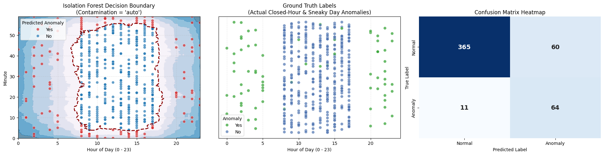

# Lab 2 — Anomaly Detection

## Overview
This lab requires us to generate synthetic data and demonstrate how we can use Machine Learning (`Isolation Forest`) to identify operational anomalies based on temporal features, moving beyond rigid threshold rules.

The generated data and Isolation Forest execution code are located in the notebook: `Isolation_Forest_with_Evaluation_Metrics.ipynb` alongside a separate `Evaluation Metrics.png` image.

---

## Scenario — Employee Access & Facility Security
Employee office activity follows structured operational hours.
This scenario analyzes a multi-day access log observation window:

* **Standard Working Hours (08:00-18:00) [Normal]:** Regular business operations where legitimate employee access and check-ins occur frequently (representing 85% of records).
* **Closed / Restricted Hours (20:00-06:00) [High-Risk Anomaly]:** The facility is locked down. Most anomalies (85% of total outliers) occur during these hours due to unauthorized or suspicious late-night access.
* **Sneaky Daytime Anomalies (08:00-18:00) [Stealth Anomaly]:** Rare, unexpected after-hours style violations occurring during regular daylight hours (representing the remaining 15% of anomalies).

---

## Methodology & Model
* **Algorithm:** Unsupervised `Isolation Forest`.
* **Concept:** Isolates observations by randomly partitioning feature space. Anomalies require fewer splits because they are sparse and distinct from the dense baseline.
* **Contextual Detection:** Evaluates access patterns via their timestamp (`hour` and `minute` of the day).

---

## Visual Metrics & Results

Overall verdict: **High Sensitivity, but prone to False Alarms.**

The model is exceptionally good at catching actual security threats (anomalies), but it is also "trigger-happy," flagging quite a few normal daytime logins as suspicious.

*(Note: These specific numbers apply to this run. When repeating the run, the results are similar.)*

### Key Takeaways
#### 1. Outstanding Anomaly Recall (85.3% / 64 out of 75 caught):
* **What it means:** Out of the 75 actual anomalies (closed-hour spikes and sneaky daytime breaches), the model successfully detected **64 of them.**
* **Why it matters:** In security monitoring, high recall is critical because we want to minimize missed threats. Missing only 11 out of 75 is a strong result for an unsupervised model.

#### 2. Moderate Anomaly Precision (51.6%):
* **What it means:** Out of all the times the model shouted "Anomaly!" (124 total flags: 64 true + 60 false), only about half were actually real threats.
* **Why it matters:** This is caused by the `contamination='auto'` setting. Because the unsupervised model didn't know the exact 15% rate, its default algorithm cast a wider net and flagged 124 records instead of the true 75, resulting in 60 False Positives (normal employees getting flagged).

#### 3. Solid Normal Recognition (97.1% Precision / 85.9% Recall):
* When the model says a login is normal, it is almost always correct (0.971 precision). However, it misclassified 60 normal daytime check-ins as anomalies because they fell near the edges of the model's learned density boundaries.

### What the Scatter Plot Tells Us

Because the model only looked at the **hour and minute,** it mapped a time-density boundary. The dense cluster of normal daytime office hours was cleanly separated from the sparse late-night hours. However, because some normal logins happen early in the morning or late in the afternoon (near the boundary edges), the unsupervised algorithm mistakenly treated them as mathematical outliers.

